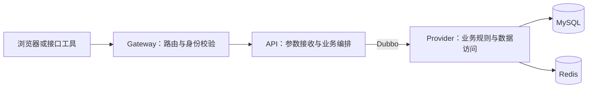

# 直播平台：从参考项目到个人项目的开发流程

创建日期：2026-11-08  
项目名称：直播平台  
开发目录：`D:\LivingPlatformByMyself`  
参考项目：`D:\dou_yu\qiyu-live`  
当前状态：阶段 01 已完成；阶段 02 用户基础代码及编译检查已完成，数据库迁移与运行验收待部署时进行。

## 1. 先回答：我们应该先写业务代码吗？

**先完成一小步工程准备，随后立即开始业务开发。**

第一步把工程启动、数据库连接和最小服务调用跑通；第二步开始用户业务，逐步完成“验证码登录 → 自动注册 → 获取登录身份 → 查询当前用户”的完整链路。这就是第一个可验收的业务成果。

我们采用“阅读一条参考链路 → 理清规则 → 在自己的工程中实现 → 验证 → 再做下一条”的方式。按功能逐步复现，每一步都要能运行、能说明白。

具体顺序如下：

> 最小工程 → 用户基础 → 登录鉴权 → 直播间 → IM 聊天 → 真实视频直播 → 钱包与送礼 → 分布式消息完善 → PK → 红包 → 带货 → 性能与部署。

原教程在用户模块早期就涉及分表、主从、缓存优化。我们的首轮先用单库单表完成正确的业务行为，再在后面的性能阶段回看这些设计。模块边界仍然沿用参考项目的思路。

## 2. 对参考项目的实际观察

本流程根据本地 README、父 POM、六篇教程及部分 Controller、Service、网关和钱包代码整理。这里只做了静态阅读，尚未验证参考项目能否在本机完整启动。

| 观察项 | 本地项目中的内容 | 对开发流程的影响 |
| --- | --- | --- |
| 后端工程 | `后端代码/qiyu-live-app`，Maven 多模块 | 按功能增加模块，保留 `interface/provider` 分工 |
| HTTP 与业务服务 | `gateway`、`api`、各领域 `provider` | 网关负责入口，API 负责接口编排，Provider 负责领域业务 |
| 技术栈记录 | 父 POM 配置 Java 17、Spring Boot 3.0.4、Dubbo 3.2.0-beta.3、Spring Cloud Alibaba 2022.0.0.0-RC1 | 这些是参考版本；新项目的具体版本在工程初始化时核验兼容性并锁定 |
| 数据与消息 | MySQL、Redis、MyBatis-Plus、ShardingSphere、Kafka、Netty 等 | 随功能引入；本地代码实际使用 Kafka，不能仅凭教程中的环境名称判断 MQ 选型 |
| 业务范围 | 用户、登录、直播间、IM、钱包、礼物、PK、红包、商品和订单 | 从依赖少的功能推进到依赖多的功能 |
| 前端 | README 指向独立前端仓库，本次指定目录中未发现完整前端工程 | 当前后端目录不能代表完整页面实现；前端阶段另行读取源码并确认技术栈 |
| 音视频 | 第二篇教程末尾有推拉流补充说明，涉及 RTMP、Nginx 模块和 HTTP-FLV | 单独安排推流、播放和断流验收，不能用开播接口成功代替视频验收 |
| 数据初始化 | 本次文件检索未发现独立 `.sql` 文件，教程中散落着建表 SQL | 每做一个领域，就整理自己的可执行建表及演示数据脚本 |

下面的接口、目录和表名是我们的开发提案；未特别注明时，不代表原项目已有同名实现。

## 3. 项目目标与阶段成果

### 3.1 我们要做出的产品

一个能够由两名用户实际演示的直播平台：主播登录后开播，观众进入直播间观看视频、发送聊天消息和赠送测试礼物。随后逐步增加 PK、红包和带货。

首轮采用本地模拟短信和模拟充值，使用测试平台币完成业务验证。真实短信通道、真实支付通道在需要时单独接入。

| 里程碑 | 用户能够做什么 | 完成阶段 |
| --- | --- | --- |
| M1：登录闭环 | 登录、自动注册、查询和修改自己的资料、退出登录 | 阶段 01～04 |
| M2：直播间互动 | 开播、查看直播间、进入房间、两名用户聊天、关播 | 阶段 05～06 |
| M3：可观看的直播 MVP | 主播推送实时画面，观众在页面观看并聊天 | 阶段 07 |
| M4：送礼闭环 | 模拟充值、查看余额、送礼、查看流水及礼物事件 | 阶段 08 |
| M5：扩展玩法 | 多节点消息、PK 积分、红包、商品与订单 | 阶段 09～12 |
| M6：可复现交付 | 按文档部署、运行演示、查看实测性能结果 | 阶段 13 |

**M3 是第一个完整的直播产品验收点。** M1、M2 是独立可运行的中间成果。

### 3.2 本轮默认的实现边界

- 后端沿用 Java、Spring Boot、Dubbo 和原项目的领域拆分方向，具体依赖版本在阶段 01 核验。
- 前端按业务进度制作登录页、首页、直播间页；先完成交互，再完善视觉。前端框架在读取独立前端源码后确定。
- 本地先运行单实例服务和单库单表；在明确需要多个 IM 节点、异步事件或性能优化时增加相应能力。
- PK 首先复现参与者、计分、进度条和结束状态。双主播实时音视频连麦需要另一个音视频方案，不算作计分功能自带的能力。
- 先使用参考项目作为阅读材料，在当前目录逐步编写新项目。直接采用原代码片段时，记录来源并保留其许可要求的声明。

## 4. 工程如何逐步建立

### 4.1 初期模块

项目英文标识暂用 `live-platform`，Java 根包暂用 `com.liveplatform`。初始目录规划如下，实际文件在阶段 01 创建：

```text
D:\LivingPlatformByMyself\
├─ docs\                         开发流程、接口约定、设计记录
├─ deploy\                       本地环境配置、配置样例
├─ sql\                          按阶段编号的数据库脚本
├─ backend\
│  ├─ pom.xml                    Maven 聚合与依赖管理
│  ├─ live-common\               最小公共返回对象、错误码等
│  ├─ live-user-interface\       用户 RPC 契约、DTO
│  ├─ live-user-provider\        用户业务、数据库访问、RPC 实现
│  └─ live-api\                  HTTP 接口与业务编排
└─ frontend\                     在页面联调阶段创建
```

第一阶段只需要 `live-api` 和 `live-user-provider` 两个业务进程。`interface` 和 `common` 是依赖包，不单独启动。随着功能推进，再添加 `account`、`msg`、`gateway`、`living`、`im`、`bank`、`gift` 等模块。

先在具体模块中实现实际需要的公共能力；出现稳定的重复需求后，再抽取类似原项目的 Web、Redis、数据源 Starter。

### 4.2 模块职责与调用方向



网关在阶段 04 接入；此前接口工具直接访问 `live-api`。

| 层次 | 负责什么 | 约束 |
| --- | --- | --- |
| Controller | 接收请求、参数校验、返回响应 | 不直接编写数据库逻辑 |
| API Service | 组合用户、账号等领域调用 | 通过 RPC 契约调用 Provider |
| Interface | 定义 RPC 接口和传输对象 | 不依赖 Provider 的实现类 |
| Provider Service | 业务规则、状态变化、领域内事务 | 业务校验不能只依靠页面按钮 |
| Mapper / PO | 数据访问与表映射 | 不直接把持久化对象当作所有外部接口的返回值 |

`account` 管理登录身份和 Token，`bank` 管理平台币和流水。两者分别对应“账号认证”和“钱包账务”，开发时保持语义清楚。

### 4.3 基础设施的引入时机

| 引入阶段 | 组件 | 本阶段用途 |
| --- | --- | --- |
| 01 | JDK、Maven、MySQL、Nacos、Dubbo | 编译、持久化、注册发现、最小 RPC 调用 |
| 03 | Redis | 验证码、登录 Token、发送频率限制 |
| 04 | Gateway | 统一入口、登录校验、跨域与身份传递 |
| 06 | Netty / WebSocket | 登录后的长连接和房间聊天 |
| 07 | 媒体服务、推流端、浏览器播放器 | 实际视频推流与播放；先核验参考教程方案 |
| 09 | Kafka、多实例 IM 路由 | 业务事件、重试、跨节点投递 |
| 13 | 按测量结果增加缓存层、分表或主从等 | 验证明确的性能问题及改进效果 |

基础组件优先复用本机已有可用环境，记录版本、端口和启动方法。应用配置使用自己的本地环境值；每个组件在被引入的阶段提供配置样例和启动检查。

## 5. Step by step 总路线

下表是实施顺序。每阶段完成后记录验收结果，再进入下一阶段；大阶段可以拆为多次开发。

| 阶段 | 开发内容 | 参考位置 | 必须获得的成果 |
| --- | --- | --- | --- |
| 00 | 明确范围、模块职责和顺序 | README、父 POM、六篇教程 | 本文；明确 M1～M6 的验收边界 |
| 01 | 最小工程与环境 | 父 POM、`user-interface/provider`、`api` | 工程可编译；API 能通过 RPC 调用用户服务；用户服务能访问数据库 |
| 02 | 用户基础 | `UserServiceImpl`、用户表设计 | 创建、查询、更新用户；数据持久化；基本异常可解释 |
| 03 | 验证码登录和 Token | `UserLoginServiceImpl`、`UserPhoneServiceImpl`、`msg`、`account` | 首次登录自动注册，再次登录返回同一用户；过期及错误验证码失败 |
| 04 | 网关鉴权与登录页面 | `AccountCheckFilter`、请求上下文、独立前端源码 | 页面登录后可查自己的资料；退出后失效；M1 完成 |
| 05 | 直播间生命周期 | `LivingRoomController`、`living-provider` | 开播、列表、详情、关播、历史记录；只有主播本人可关闭自己的房间 |
| 06 | 单节点 IM 与聊天页面 | `im-core-server`、`im-provider`、第二篇教程 | 两名用户进入同一房间实时聊天，其他房间收不到消息；M2 完成 |
| 07 | 真实视频链路 | 第二篇教程推拉流补充、前端播放器 | 主播推流，观众观看实时画面；断流可感知；M3 完成 |
| 08 | 钱包、模拟充值、礼物 | `bank`、`bank-api`、`gift`、第三篇教程 | 余额与流水一致；重复送礼不重复扣费；房间收到礼物事件；M4 完成 |
| 09 | IM 路由与可靠异步处理 | `im-router`、Kafka 消费者、ACK 处理 | 两个 IM 节点之间可投递；重复、失败和重启场景有可验证处理 |
| 10 | PK 玩法 | 第四篇教程、PK 相关 Lua | 参与、送礼计分、进度广播、退出与结束；重复事件不重复计分 |
| 11 | 红包雨 | 第五篇教程、红包服务和消费者 | 准备、开始、领取、入账；不超领、不重复领，账务可核对 |
| 12 | 直播带货与订单 | 第六篇教程、商品/库存/订单服务 | 商品列表、购物车、下单、模拟支付、超时取消、库存回补 |
| 13 | 测试、性能、部署、演示 | 原项目压测材料及各模块 | 一套可按文档复现的部署步骤、演示数据、回归场景和性能报告 |

## 6. 前几次开发怎样具体推进

### 第 1 次：建立能运行的最小工程

**目标：** 开始下一次开发时，能够在新工程中调通一次服务调用。

1. 检查本机 JDK、Maven、MySQL、Redis、Nacos 的现状，区分已安装、可连接和需要准备的组件。
2. 根据参考 POM 核验依赖组合，查阅对应官方兼容说明并锁定版本；不把原项目的 beta / RC 组合直接当作新项目默认版本。
3. 创建第 4 节中的后端初始模块，以及必要的配置样例和忽略规则。
4. 创建 API 和用户服务启动类，提供健康检查与一个最小用户 RPC 调用。
5. 创建独立开发数据库，确认用户服务可以连接；记录启动次序和端口。

**验收：** Maven 编译通过，两个服务可启动，接口工具访问 API 后能得到用户服务的响应；数据库连通性有实际验证结果。

这一步控制在最小范围，完成后进入用户业务。Redis 可先盘点，到验证码登录时再接入。

### 第 2 次：用户表与用户基础业务

**目标：** 第一组真实持久化业务可运行。

1. 读取原项目用户 PO、Mapper、RPC 和 `UserServiceImpl`。
2. 设计用户表及字段：用户 ID、昵称、头像、状态、创建和更新时间；首轮使用单表。
3. 明确用户 ID 的生成方式；使用测试数据准备初始用户。
4. 实现创建用户、按 ID 查询、修改资料的 Service 与 RPC；创建能力供注册链路调用。
5. 从 API 调用查询能力，记录成功、用户不存在、非法参数的请求样例。

**验收：** 新建的数据在重启后仍可查到，更新结果正确，非法请求得到约定的错误响应。

涉及指定用户 ID 的调试入口只用于本地验证；接入页面后，修改“我的资料”使用认证身份。

### 第 3 次：验证码与登录注册

**目标：** 用本地模拟短信跑通完整登录链路。

1. 增加 `live-msg-interface/provider`，提供验证码生成、校验和发送频率控制。
2. 模拟短信发送器只在本地开发配置中启用，验证码仍然有有效期、错误次数限制和使用后失效规则。
3. 参考手机号映射设计，增加手机号与用户关系表，对规范化后的手机号建立唯一约束。
4. 在用户服务内完成“查手机号 → 已存在则返回 → 不存在则创建”的注册逻辑；用户及手机号关系在同一事务内写入。
5. 增加 `live-account-interface/provider`，生成随机 Token，存入 Redis，配置有效期。
6. API 编排验证码检查、用户注册/查询和 Token 签发。

**验收：** 首次登录创建一个用户；并发或重复登录不产生重复账号；验证码错误、过期、重复使用、发送过频均有明确结果。

### 第 4 次：网关与当前用户

**目标：** 形成可供页面使用的登录接口体系。

1. 新建 `live-gateway`，接入登录白名单和 Token 校验。
2. 采用服务端 Token 会话思路；浏览器端默认使用 Cookie，具体 Cookie 属性和跨域设置按本地部署方案统一。
3. 网关清理外部传入的内部身份头，再写入认证得到的用户 ID；部署入口限制也要与这个信任约定一致。
4. 实现当前用户查询、修改自己的资料、退出登录；后端以认证身份确定操作者。
5. 统一未登录、Token 过期、权限不足的状态码和响应结构。

**验收：** 未登录无法查询私有资料；伪造用户 ID 不能代替登录；退出后旧 Token 不能继续访问。

### 第 5 次：完成登录页面与 M1 联调

**目标：** 用户可以通过页面完成登录、查看资料和退出。

1. 读取 README 指向的独立前端项目，确认页面结构、技术栈、接口格式和本地启动方式。
2. 建立自己的前端工程，完成登录页、资料展示和统一请求处理。
3. 将接口错误转为可理解的页面提示，处理加载状态和重复点击。
4. 完成两个浏览器会话的登录验证，确认登录身份彼此独立。

**验收：** 从页面操作到数据库、Token、当前用户查询均可追踪；M1 完成。

页面源码暂时不可用时，先用简单页面完成上述交互；视觉复现需要取得对应前端或明确的视觉参考后再推进。

### 第 6 次开始：进入直播间业务

依次实现开播、列表、详情、关播，再添加 IM 和视频。每次只完成其中一条可验证链路。到这里才逐步进入直播平台特有的业务。

## 7. 后续阶段必须明确的业务规则

### 7.1 直播间与真实开播

首轮规划直播间和直播历史记录两类数据，明确主播身份、房间 ID、标题、封面、状态和起止时间。先约定同一主播是否只允许一个进行中的直播场次，并通过服务端约束保证重复开播不会创建多个有效场次。

阶段 05 的“开播”表示业务状态建立；阶段 07 再把业务状态与实际推流状态关联。需要考虑“准备开播、正在推流、断流、已结束”，并定义重复关播、主播断线和重连后的行为。

真实视频验收链路是：

```text
主播采集画面 → 推流到媒体服务 → 观众播放器拉流 → 页面显示实时画面
```

业务后端负责房间、身份和流地址相关管理，IM 负责聊天事件。媒体服务负责视频流传输。先复现单主播推流和浏览器播放，再讨论连麦、录制、转码等扩展。

### 7.2 IM 聊天

先完成一个 IM 节点：连接认证、绑定用户和房间、心跳、断线清理、房间广播。消息使用唯一 ID，并明确类型、房间、发送者、时间和内容。发送者以服务端认证身份为准。

阶段 09 再加入在线路由、多节点投递、ACK、超时重试与去重。ACK 需要明确表示“客户端收到”还是其他状态；业务扣款成功与消息收到分别记录。验收时安排两个用户连接不同 IM 节点，并验证跨节点广播。

### 7.3 钱包、模拟充值与礼物

先做平台币账户和流水，再做礼物配置与送礼。币值使用整数最小单位；校验正数、数量上限及计算溢出。金额和价格以服务端数据为准。

阶段 08 先以同步调用完成扣款结果确认：钱包服务用数据库事务同时完成余额变更和流水写入，并使用业务请求号保证重复调用返回相同结果。并发扣款必须保证余额不为负数。

跨钱包和礼物服务的操作不视为一个本地事务：送礼服务先持久化请求号及处理状态，再以同一请求号调用钱包，记录成功/失败并推送事件。遇到超时或进程中断时，可以查询钱包处理结果并补齐礼物记录。重复推送由事件 ID 去重。

模拟充值也经过充值订单、模拟回调、入账和流水链路；同一订单多次回调只能入账一次。礼物价格快照和接收方信息随记录保存，便于事后核对。

阶段 09 改为异步处理时，接口返回“已受理”和“已完成”的语义必须区分。为关键事件设计持久化发送记录、投递重试、消费幂等和失败补偿；不能把调用发送方法直接当作业务完成。

**关键验收：** 余额不足不扣款；并发送礼余额不为负；同一请求只扣一次；扣款后服务重启仍能恢复礼物处理结果；流水能够解释余额变化。

### 7.4 PK、红包和带货

| 业务 | 进入条件 | 首轮实现重点 | 关键验收 |
| --- | --- | --- | --- |
| PK | 房间、送礼事件及 IM 已可用 | 会话 ID、参与者、起止时间、积分、结束状态；按事件 ID 去重 | 一个礼物事件只计一次分，过期会话不再计分，乱序广播不让进度倒退 |
| 红包 | 钱包入账、事件重试及 IM 已可用 | 总额与份数、准备/开始/结束、领取记录、钱包入账、未领取余款处理 | 总领取额不超过配置总额；同一用户按规则只能领一次；重复消费不重复入账 |
| 带货 | 用户、房间、钱包和异步处理已可用 | 商品、库存、购物车、订单、支付和取消状态迁移 | 不超卖；重复支付不重复扣款；取消只回补一次库存；支付与超时取消冲突有确定结果 |

原项目将部分商品逻辑放在 `gift-provider` 内。到阶段 12 时再决定是否拆出 `live-shop`，并记录与参考设计的差异。

## 8. 每开发一个功能，固定走这七步

1. **写清业务行为。** 谁发起、需要什么权限、成功后产生什么结果、失败时如何返回。
2. **只读相关参考链路。** 从 Controller 到 API Service、RPC、Provider Service、Mapper，再看必要的消息处理和前端调用。
3. **确定数据和接口。** 表字段、索引、状态、请求响应、事务和幂等边界，写成短说明。
4. **实现最小可运行版本。** 创建该功能需要的文件和配置，完成持久化和基本业务。
5. **验证关键场景。** 成功、参数错误、身份或权限不符；涉及余额和库存时增加并发、重复请求与失败恢复验证。
6. **接入页面并演示。** 能从用户操作走到真实后端；页面暂未到开发阶段时保留接口请求样例。
7. **记录并收尾。** 更新启动说明、SQL、接口说明和本次验收结果，再进入下一步。

每次开发结束应能回答四个问题：这次用户多了什么能力？参考了哪里？为什么这样实现？如何证明它可以工作？

## 9. 第一条业务链路的接口草案

下列接口是新项目草案，正式编码时统一入参和返回结构。若后续采用原前端，需要在前端请求层或后端适配层完成映射，不默认与原接口兼容。

| 方法与路径 | 用途 | 登录要求 |
| --- | --- | --- |
| `POST /api/auth/code` | 申请登录验证码 | 无，限制发送频率 |
| `POST /api/auth/login` | 验证码登录，必要时注册 | 无，验证成功后签发会话 |
| `GET /api/users/me` | 查询当前用户 | 需要 |
| `PATCH /api/users/me` | 修改自己的昵称、头像等 | 需要 |
| `POST /api/auth/logout` | 使当前会话失效 | 需要；重复退出的行为需一致 |

暂定统一响应包含 `code`、`message`、`data`、`requestId`，并约定 HTTP 状态码的使用。长整型 ID 在对外 JSON 中按字符串表示，避免前端数值精度问题。

M1 验收按以下顺序进行：获取本地验证码 → 首次登录 → 查询自己 → 修改昵称 → 再次查询 → 退出 → 验证旧会话失效 → 再次登录确认仍为同一用户。

## 10. 复现时需要重新判断的地方

参考项目用于理解设计，具体实现仍需通过我们的验证。已经阅读到的例子包括：

- `UserLoginServiceImpl` 中存在 `code != null || code >= 1000` 这样的校验表达式。我们需要按业务规则重写并验证空值、错误值，不能直接保留条件。
- `GiftServiceImpl` 发起 Kafka 发送后直接返回 `true`。我们要明确请求受理、消息投递、扣款完成三个结果分别如何对外表达。
- 钱包代码包含 Redis 余额操作和线程池异步数据库更新。我们的初版优先建立可核对的数据库账务，再逐步设计异步处理与恢复机制。
- 原项目部分校验和跨域配置围绕作者的本地环境编写。我们要根据自己的入口和端口统一配置，并在浏览器中实际联调。

性能优化按“记录基线 → 识别问题 → 解释方案 → 实现 → 同条件复测”推进。单库单表已经满足当前演示负载时，分库分表可以作为独立学习实验，避免让它阻塞主业务。

阶段 13 的报告记录机器资源、数据量、并发量、请求类型、吞吐量、延迟和错误率；只描述实际测出的结果。

## 11. 文档与交付约定

以下内容随开发逐步补齐，不要求在开始业务前全部写完：

| 交付物 | 何时更新 |
| --- | --- |
| 根目录 README | 阶段 01 建立，持续补充启动与演示步骤 |
| 环境与版本清单 | 每次引入组件或修改依赖时 |
| 编号 SQL 和演示数据 | 每次新增或调整表结构时 |
| 接口说明与请求样例 | 每条接口完成时 |
| 设计差异记录 | 与参考项目的重要设计不同之处发生时 |
| 测试或人工验收记录 | 每次阶段交付时 |

对登录权限、状态转换、余额、库存、幂等和失败恢复做有意义的自动化验证。页面样式、简单文案等低影响变更采用针对性检查；每次测试范围与实际变更相匹配。

## 12. 参考材料入口与当前进度

以下均为本机已读取或检索确认的文件：

- [参考项目说明](D:/dou_yu/qiyu-live/README.md)
- [后端父 POM](D:/dou_yu/qiyu-live/后端代码/qiyu-live-app/pom.xml)
- [系统架构与用户中台](D:/dou_yu/qiyu-live/1-系统架构分析与用户中台的实现.md)
- [IM 与视频推拉流补充](D:/dou_yu/qiyu-live/2-即时通讯(IM)系统的实现.md)
- [钱包与送礼](D:/dou_yu/qiyu-live/3-直播送礼打赏功能的实现.md)
- [PK 功能](D:/dou_yu/qiyu-live/4-直播PK功能的实现.md)
- [红包雨](D:/dou_yu/qiyu-live/5-直播间红包雨功能的实现.md)
- [带货秒杀](D:/dou_yu/qiyu-live/6-直播带货秒杀功能的实现.md)

当前进度：

- [x] 阅读本地参考项目结构和关键实现，整理业务依赖。
- [x] 编写本开发流程，划分阶段和验收标准。
- [x] 阶段 01：检查开发环境，建立自己的最小工程。
- [ ] 阶段 02：用户基础代码与编译检查已完成；待执行 002 SQL、重新打包和运行验收。
- [ ] 阶段 03～04：完成登录、鉴权和页面联调，达成 M1。
- [ ] 阶段 05～07：完成直播间、聊天和真实视频，达成 M3。
- [ ] 阶段 08～13：逐步完成送礼、扩展玩法和交付。

**用户 Redis 缓存基础能力已编码并打包，见 docs/05-用户缓存基础设计.md。下一次开发任务：热点缓存重建互斥锁；失效持久化与重试再单独推进。**

## 13. 后续推进约定

按用户最新要求，每次只推进一个明确的小阶段，以项目代码、正确配置和设计说明为主要交付。默认只做必要的编译检查；涉及账务、锁和并发状态转换时，再做针对性的关键验证。不重复执行已通过的环境检查、全链路测试或大范围测试。

缓存一致性、锁、IM 等技术亮点按业务依赖逐步实现，具体方案见 `docs/03-核心技术设计与实施顺序.md`。文档中的规划项不会标记为已实现。
